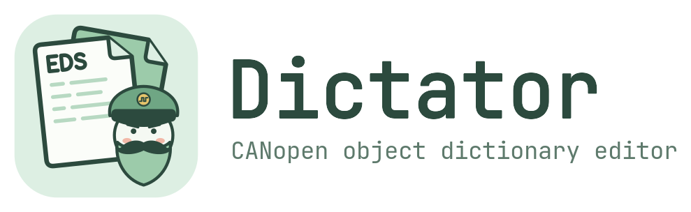
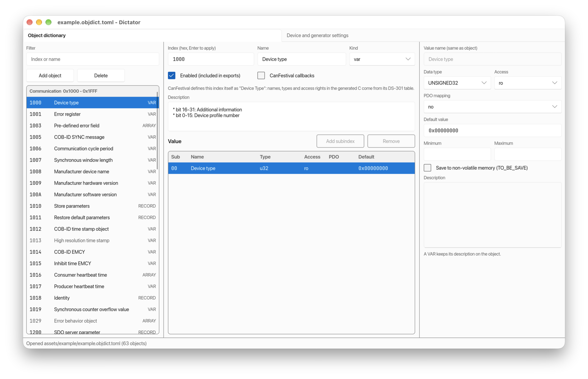
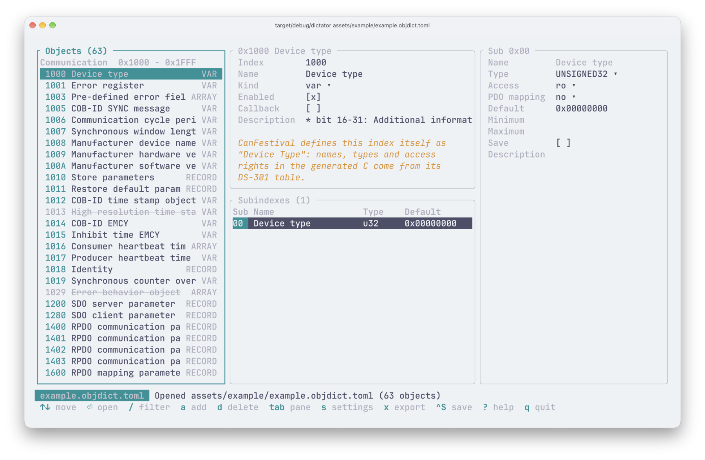

<p align="center">
  <picture>
    <source media="(prefers-color-scheme: dark)" srcset="assets/icon/banner-dark.png">
    
  </picture>
</p>

# Dictator

[](https://github.com/golovinengineer/canopen-dictator/actions/workflows/ci.yml)

A cross-platform CANopen object dictionary editor. You edit the dictionary
in a plain-text project file that stays readable in git diffs. Dictator
imports existing projects from other tools, and from the project file it
generates the C object dictionary for your CANopen stack, EDS and Markdown
docs.

It runs as a desktop window (Slint) or as a terminal UI (Ratatui) from the
same binary. A small command line handles imports and exports in scripts and
CI.

<p align="center">
  
  <br><em>The desktop window</em>
</p>

<p align="center">
  
  <br><em>The terminal UI, same binary</em>
</p>

## Why

CANopen tooling is split by stack and by platform. Each C stack comes with
its own editor and its own file format: CanFestival has `objdictedit`
(wxPython), CANopenNode has CANopenEditor (.NET, mainly Windows), and the
commercial tools are Windows-only. EDS is the format everyone shares, but it
isn't pleasant to edit or review. Moving a device between stacks, or
between machines, usually means re-entering the dictionary.

Dictator aims to be one editor for all of them:

- **Cross-platform, one binary.** Written in Rust, with a native window
  (Slint) and a terminal UI (Ratatui). It's developed on macOS, and the same
  code targets Linux and Windows. The command line needs neither front end,
  so it runs on any CI runner or headless box.
- **Many formats in, many out.** Bring in a CANopenEditor XDD or a
  CanFestival `.od` today. EDS import is next. From one project, generate
  EDS for integrators, Markdown docs, and the C object dictionary for your
  stack.
- **C library for your stack.** CanFestival-family C is done: Dictator
  targets [co_stack](https://github.com/RoboticsHardwareSolutions/co_stack),
  a CanFestival fork that diverged from CanFestival 3.x, and its output is
  token-identical to that fork's `gen_cfile`, so firmware symbol names don't
  change when you switch. CANopenNode v4 `OD.c`/`OD.h` is next, then current
  upstream [CanFestival](https://github.com/beremiz/canfestival), reworked in
  2026 with DCF project files.
- **Not tied to one stack.** The same project generates code for each
  supported stack, so a team moving a device from one stack to another can
  build both from one dictionary during the move, instead of maintaining it
  twice. CanFestival and CANopenNode come first; other stacks can follow as
  they appear.
- **A project file made for git.** One `*.objdict` per device, written
  in a stable order with one line per subindex and no timestamps. A change
  shows up in review as exactly the lines it touched.
- **Reproducible builds.** Exporting an unchanged project gives
  byte-identical files, so the C code can be generated in CI instead of
  committed (see [Generating code in CI](#generating-code-in-ci)).

## Formats

| Format | Import | Export | Notes |
| --- | :---: | :---: | --- |
| `*.objdict` (Dictator project) | ✓ | ✓ | the native format, TOML; `*.objdict.toml` opens too |
| CANopenEditor XDD (4.x) | ✓ | | |
| CanFestival `.od` | ✓ | ✓ | opens in CanFestival 3.x `objdictedit` |
| CanFestival C (`.c` + `.h`) | | ✓ | for co_stack; token-identical to `gen_cfile` |
| EDS | | ✓ | CANopenEditor's layout |
| Markdown documentation | | ✓ | CANopenEditor's layout |

CANopenNode v4 `OD.c`/`OD.h`, XDD export and EDS import are planned; see
[the issue tracker](https://github.com/golovinengineer/canopen-dictator/issues).

The project file is TOML under its own extension. To keep TOML highlighting,
add this line to the repository's `.gitattributes` for GitHub:

```
*.objdict linguist-language=TOML
```

and this to the VS Code settings:

```json
"files.associations": { "*.objdict": "toml" }
```

## Installing

### macOS app

With [Homebrew](https://brew.sh):

```sh
brew install --cask golovinengineer/tap/dictator
```

That installs `Dictator.app` into Applications and links its binary as
`dictator`, so the command line and the terminal UI work from a shell too.
`brew upgrade` picks up new releases.

Or by hand: download `Dictator-<version>-macos-universal.dmg` from
[Releases](https://github.com/golovinengineer/canopen-dictator/releases),
open it and drag `Dictator.app` onto the Applications folder next to it
(a `.zip` with the same app is there too). It runs on Apple Silicon
and Intel Macs with macOS 11 or later.

The app is not signed with an Apple Developer ID yet, so macOS blocks the
first start, whichever way you installed it (Homebrew quarantines its
downloads too). Open System Settings → Privacy & Security and click **Open
Anyway**, or clear the quarantine flag once in a terminal:

```sh
xattr -dr com.apple.quarantine /Applications/Dictator.app
```

The binary inside the app is also the command line and the terminal UI.
Homebrew links it for you; after a manual install, choose File → Install
Command Line Tool in the app, or link it into `/usr/local/bin`, which is on
macOS's default `PATH`, by hand:

```sh
sudo mkdir -p /usr/local/bin
sudo ln -sf /Applications/Dictator.app/Contents/MacOS/dictator /usr/local/bin/dictator
```

### With Cargo

With a recent stable Rust toolchain (the crates use edition 2024), install
it from crates.io; the package is `canopen-dictator`, the command it
installs is `dictator`:

```sh
cargo install canopen-dictator
```

Or build it from source:

```sh
git clone https://github.com/golovinengineer/canopen-dictator.git
cd canopen-dictator
cargo install --path .
```

That builds both front ends. For a terminal-only binary without Slint, for
example on a machine you reach over SSH, use:

```sh
cargo install --path . --no-default-features --features tui
```

With `--no-default-features` alone you get just the command line
(`check`, `import` and `export`), which is what a CI job needs.

On Linux, the Slint window needs the usual desktop development packages
(fontconfig, xkbcommon, and Wayland or X11). See
[Slint's platform notes](https://slint.dev/docs) if the build complains.

## Quick start

Open the example project that comes with the repository:

```sh
dictator assets/example/example.objdict
```

The example uses every data type the formats know, including a
UNICODE_STRING object (0x200D) that CanFestival has no C type for. To try
the C export on it, disable that object first.

Bring in an existing CANopenEditor or CanFestival project:

```sh
dictator import MyDevice.xdd MyDevice.objdict
```

Generate everything the firmware and the integrators need:

```sh
dictator export MyDevice.objdict \
    --c src/ObjDict.c --eds MyDevice.eds --md docs/MyDevice.md
```

You can also open an `.xdd` or `.od` directly in the editor. Saving then
asks for a new `.objdict` name next to it.

## Window or terminal

```sh
dictator [--gui | --tui] [PROJECT]
```

Dictator picks the front end in this order:

1. `--gui` or `--tui` on the command line;
2. the `DICTATOR_UI` environment variable (`gui` or `tui`);
3. the terminal UI when both stdin and stdout are a terminal, otherwise the
   window.

If you prefer the window even when you start Dictator from a shell, put
`export DICTATOR_UI=gui` in your shell profile.

Both front ends edit the same way. The window shows invalid values with a
red outline. The terminal UI won't accept them and tells you why.

> **macOS:** start `Dictator.app` for the window. Double-clicking the bare
> `dictator` binary in Finder opens it in your terminal app, so you get the
> terminal UI.

### Terminal UI keys

Press `?` in the app for this list.

| Keys | Action |
| --- | --- |
| `↑↓` `j` `k`, `PgUp` `PgDn`, `g` `G` | move in a list or form |
| `Tab` / `Shift-Tab`, `←→` `h` `l` | switch pane |
| `/` | filter objects by name, index or subindex name |
| `Enter` `e` | edit a field, pick a choice, toggle a check box |
| `Space` | toggle a check box |
| `a` | add an object or a subindex |
| `d` `Del` | delete the object or subindex (asks first) |
| `s` `F2` | device and generator settings |
| `Ctrl-S` | save (asks for a file name the first time) |
| `Ctrl-O` / `Ctrl-N` | open a project or import `.xdd` / `.od` / new project |
| `x` | export C, `.od`, EDS or Markdown |
| `q` `Ctrl-C` | quit (asks about unsaved changes) |

Text fields take readline keys: `Ctrl-A`/`Ctrl-E` to jump to the start or
end, `Ctrl-U`/`Ctrl-K` to clear, `Ctrl-W` to delete a word. File prompts
complete paths with `Tab` and expand `~`.

## Command line

```
dictator export PROJECT [--c FILE.c] [--od FILE.od] [--eds FILE.eds] [--md FILE.md] [--strict]
dictator check PROJECT [--strict]
dictator import FILE.xdd|FILE.od OUT.objdict
dictator cmake install | uninstall | dir
dictator --help
dictator --version
```

`export` writes every requested file in one run, and `--c` writes the
matching `.h` next to the `.c`. Importing a `.od` can give warnings about
what could not be carried over; with `--strict` they make `export` fail
without writing anything, so a build stops on them. `check` loads the
project as `export` does and writes nothing: it fails on values that don't
fit their type, and with `--strict` on those warnings too. Problems specific
to one output, such as a type CanFestival C has no equivalent for, show up
only in `export`. None of these needs a display or a
terminal. `--version` (also `-V` or `-v`) prints `dictator` and
the version, for checking which binary is on `PATH`.
`cmake` sets up `find_package(Dictator)`; see
[Using with CMake](#using-with-cmake).

## Generating code in CI

Keep only the `*.objdict` in the firmware repository and let the
pipeline produce the C library, the EDS and the docs from it. Every export
of the same project gives the same bytes, so the result is reproducible.
[canopen-dictator-example](https://github.com/golovinengineer/canopen-dictator-example)
is a complete setup to copy: a CMake firmware project whose GitHub Actions
workflow checks the project, builds it and publishes the EDS and docs.

`dictator check PROJECT --strict` gates a pipeline on a correct object
dictionary without generating anything.

**GitHub Actions**: the action in this repository installs the command line
(built with `--no-default-features`, so no GUI or terminal libraries),
caches it, puts `dictator` on `PATH` and runs `dictator cmake install`, so a
CMake build's `find_package(Dictator)` needs no hints (see
[Using with CMake](#using-with-cmake)). It builds with the runner's Rust
toolchain, which GitHub's Linux and macOS runners have. Pinned to a release
tag it installs that version from crates.io; `version: X.Y.Z` picks another
(0.2.0 or newer), and any other ref builds the action's own source.

```yaml
name: object dictionary
on: [push, pull_request]

jobs:
  generate:
    runs-on: ubuntu-latest
    steps:
      - uses: actions/checkout@v7
      - uses: golovinengineer/canopen-dictator@v0.2.0
      - run: dictator check device.objdict --strict
      - run: |
          dictator export device.objdict \
            --c generated/ObjDict.c --eds generated/device.eds --md generated/device.md
      - uses: actions/upload-artifact@v7
        with:
          name: object-dictionary
          path: generated/
```

**Other CI**: install the same build from crates.io with a Rust toolchain,
cache it on the version, and for a CMake build run `dictator cmake install`
after it. GitLab CI, `.gitlab-ci.yml`:

```yaml
object-dictionary:
  image: rust:latest
  variables:
    DICTATOR_VERSION: "0.2.0"
    CARGO_HOME: $CI_PROJECT_DIR/.cargo
  cache:
    key: dictator-$DICTATOR_VERSION
    paths: [.cargo/bin/]
  script:
    - export PATH="$CARGO_HOME/bin:$PATH"
    - command -v dictator || cargo install canopen-dictator
        --version $DICTATOR_VERSION --locked --no-default-features
    - dictator check device.objdict --strict
    - dictator export device.objdict
        --c generated/ObjDict.c --eds generated/device.eds --md generated/device.md
  artifacts:
    paths: [generated/]
```

Later jobs can pick up the generated files as artifacts. Attach the EDS
and the Markdown to a release so integrators get files that match the
firmware.

**If you'd rather commit the generated files**, for example so the firmware
builds without Dictator, add a check that fails when someone edits the
project but forgets to regenerate:

```sh
dictator export device.objdict --c firmware/ObjDict.c
git diff --exit-code firmware/
```

## Using with CMake

`cmake/Dictator.cmake` (CMake 3.20 or newer) generates the object
dictionary as part of the firmware build, so only the project file is
committed:

```cmake
find_package(Dictator 0.2 REQUIRED)  # or include(path/to/Dictator.cmake)
dictator_add_object_dictionary(od
    PROJECT  ${CMAKE_CURRENT_SOURCE_DIR}/device.objdict  # or .xdd / .od
    STACK    canfestival
    NAME     ObjDict           # ObjDict.c / ObjDict.h
    LINK     canfestival       # your target that provides the co_stack headers
    EDS      device.eds        # optional, built by `od_docs`
    MARKDOWN device.md)        # optional, built by `od_docs`
target_link_libraries(firmware PRIVATE od)
```

`od` is a static library built from `<build>/od/ObjDict.c`; linking it makes
`#include "ObjDict.h"` work and brings the `LINK` targets along. The code is
regenerated only when the project file or the `dictator` binary changes,
always with `--strict`. `EDS` and `MARKDOWN` paths are relative to the current
build directory; `cmake --build build --target od_docs` writes them.

The module runs `DICTATOR_EXECUTABLE` if set, else `dictator` from `PATH`.
A version given to `find_package` is checked against `dictator --version`.
There are three ways to make the module available:

- **`dictator cmake install`**, once per user, however Dictator was
  installed. It writes the package to `~/Library/Application
  Support/dictator/cmake` on macOS (`$XDG_DATA_HOME/dictator/cmake`, by
  default `~/.local/share/dictator/cmake`, elsewhere) and registers it in
  CMake's user package registry (`~/.cmake/packages/Dictator`), so a plain
  `find_package(Dictator)` works in any project, without `-D` flags or sudo.
  The installed package runs the binary that installed it, wherever it is
  and whatever is on `PATH`, unless `DICTATOR_EXECUTABLE` is set; run it
  again after moving the binary. A newer binary's `cmake install` replaces
  the files. `dictator cmake uninstall` removes them and the registry
  entry; `dictator cmake dir` prints the directory, for `Dictator_DIR`.
- **`-DDictator_DIR=<checkout>/cmake`**, pointing at this repository's
  `cmake/` directory.
- **Vendoring or `FetchContent`**: copy `cmake/Dictator.cmake` into your
  project, or fetch this repository, and `include()` it.

Dictator runs on the build host, so cross-compiling the firmware makes no
difference. [`tests/cmake/`](tests/cmake/) is a working example.

## The project file

A project holds device information, CanFestival generator settings and one
table per object:

```toml
format = 1

[device]
vendor_name = "Example Vendor"
product_name = "Example Device"
baud_rates = [125, 250, 500, 1000]
rpdo_count = 4
tpdo_count = 4

[canfestival]
node_name = "ExampleDevice"
node_id = 0
node_type = "slave"

[object.0x1017]
name = "Producer heartbeat time"
kind = "var"
type = "u16"
access = "rw"
default = "1000"

[object.0x1800]
name = "TPDO communication parameter"
kind = "record"
sub = [
  { sub = 0x00, name = "Highest sub-index supported", type = "u8", access = "ro", default = "0x06" },
  { sub = 0x01, name = "COB-ID used by TPDO", type = "u32", access = "rw", default = "$NODEID+0x180" },
  { sub = 0x02, name = "Transmission type", type = "u8", access = "rw", default = "254" },
]
```

- A VAR keeps its value on the object table.
- An ARRAY or RECORD lists its subindexes in `sub`, with sub 0 written
  explicitly.
- Defaults and limits are strings, so `0x22000508` and `$NODEID+0x180` stay
  as you typed them.

The format is documented at the top of
[`crates/canopen-dictator-core/src/project.rs`](crates/canopen-dictator-core/src/project.rs),
and [`assets/example/example.objdict`](assets/example/example.objdict)
uses every feature.

You can edit the file by hand. Dictator rewrites it in its canonical form
on save, but comments are not kept yet.

## CanFestival compatibility

The C generator is a port of CanFestival's `objdictgen`, and it keeps that
tool's naming rules. Two things can be surprising:

- Objects in CanFestival's DS-301 table (0x1000–0x1BFF) take their C names,
  types and access from that table, not from your project.
- Sub 0 of an array is the highest subindex present, not the default you
  set.

The [architecture notes](docs/ARCHITECTURE.md#what-canfestival-compatible-means-here)
lists every rule and the few deliberate differences from the Python tool.

## Status

Dictator is at 0.2, and the main workflow works: import, edit, save and
export in both front ends. The golden tests check each importer and exporter
against files made by the original tools. Planned next:

- a validation panel;
- a PDO mapping editor;
- templates for standard objects;
- undo/redo;
- CANopenNode output;
- packaging.

The [issue tracker](https://github.com/golovinengineer/canopen-dictator/issues) tracks all of it.

## Development

```sh
cargo test --workspace                # unit and golden tests
cargo clippy --workspace --all-targets
cargo run -- --gui path/to/project    # the window (a plain `cargo run` in a terminal opens the TUI)
```

| Crate | Contents | Licence |
| --- | --- | --- |
| `canopen-dictator` (repository root) | GUI, terminal UI and command line (the `dictator` binary) | MIT OR Apache-2.0 |
| `crates/canopen-dictator-core` | model, project file, editing session, XDD import, EDS and Markdown export | MIT OR Apache-2.0 |
| `crates/canopen-dictator-canfestival` | CanFestival C generator, `.od` import and export, a port of CanFestival `objdictgen` | LGPL-2.1-or-later |

Both front ends drive the same editing session
(`canopen_dictator_core::editor::Editor`). New editing behaviour belongs there, so
the window and the terminal UI both get it.

The golden files in [`assets/example/`](assets/example/README.md) were
produced by CANopenEditor and CanFestival. That README explains how to
regenerate them. [`docs/ARCHITECTURE.md`](docs/ARCHITECTURE.md)
records the design decisions and notes on each file format.

Each change is a branch and a pull request into `main`, titled
`area: summary` and labelled, so it shows up in the right section of the
release notes. `main` takes merge commits only, so every commit is kept;
each should build and pass on its own. A release is a `vX.Y.Z` tag on
`main`.

## Licence

Dictator is licensed under either of [Apache License 2.0](LICENSE-APACHE) or
[MIT](LICENSE-MIT), at your option, **except** `crates/canopen-dictator-canfestival`.
That crate is derived from CanFestival (© Edouard Tisserant, Francis Dupin,
Laurent Bessard) and is licensed under the
[GNU LGPL 2.1 or later](crates/canopen-dictator-canfestival/COPYING).
A `dictator` binary contains both, so whoever distributes one also takes on
the LGPL obligations for that crate: provide its source and allow relinking.

The GUI uses [Slint](https://slint.dev) under the Slint Royalty-free License
2.0. The `AboutSlint` widget in the app's About dialog meets its attribution
condition.

The authors of Dictator place no licence conditions on the files you
generate with it (C, `.od`, EDS, Markdown).
